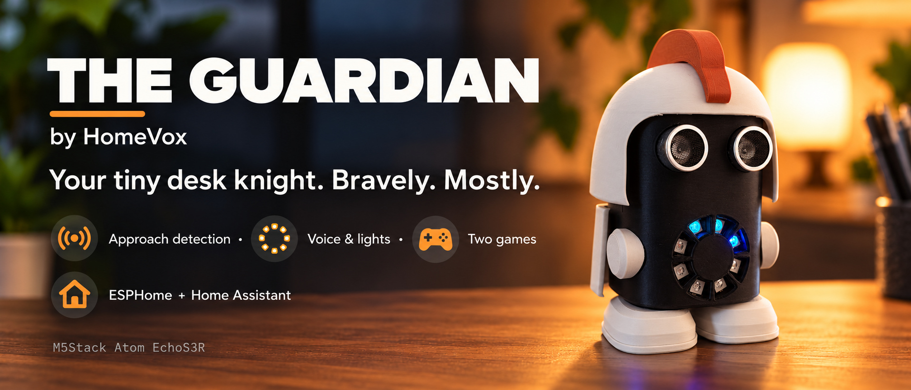

# 🛡️ The Guardian by HomeVox

**A tiny desk knight. A big personality.**

<a href="#what-he-does">Features</a> &nbsp; · &nbsp; <a href="#firmware-and-home-assistant">Setup</a> &nbsp; · &nbsp; <a href="#try-his-games">Games</a> &nbsp; · &nbsp; <a href="https://makerworld.com/en/models/3399513-the-guardian-a-tiny-home-assistant-desk-knight">Print files</a>

---

The Guardian keeps watch from your desk. When someone approaches, his LED ring lights up and he delivers a brave warning. Then comes the punchline, and his confidence falls apart.

> “I'm a mighty warrior.”
>
> “On desk scale.”

An **M5Stack Atom EchoS3R**, an ultrasonic sensor and an eight-LED ring give this printed knight his senses, lights and voice. ESPHome handles detection and lighting; Home Assistant supplies the spoken lines through TTS.

## ✨ Features

| Feature | What happens |
|---|---|
| Approach detection | An ultrasonic sensor watches for changes in distance, with adjustable range, sensitivity and a dead zone |
| LED alerts | Closer approaches produce more light; choose from 11 alert animations and four colour schemes |
| Voice and humour | Paired warning lines in English or Dutch: a brave opening, then a punchline |
| Idle character | Occasional chatter, sleep remarks and wake-up lines |
| Two games | Hot or cold, and Red light, green light |
| Quiet and sleep | Quiet hours, volume control and an optional room-presence sleep automation |
| HA controls | Detection, lighting, speech timing, games and sleep settings on the device page |

The second warning line plays when the visitor comes closer **or when the configured delay expires**. You can adjust both the distance and the timing.

## 🧰 What you need

- **M5Stack Atom EchoS3R**: controller and speaker.
- **HC-SR04P** ultrasonic sensor, suitable for 3.3 V operation.
- **WS2812 ring** with eight LEDs and a 16 mm centre opening.
- Approximately seven female Dupont wires.
- USB-C cable and 5 V supply.
- The printed enclosure parts.

## 🖨️ Printing & assembly

[Get the print profile on MakerWorld](https://makerworld.com/en/models/3399513-the-guardian-a-tiny-home-assistant-desk-knight), or use the files in `models/`.

The model has eight parts: a black body, white helmet, cape, shoulders and feet, and an orange crest. The parts click or clamp together without glue. Use the supplied profile for print orientation and settings; time and filament use depend on your printer and profile.

1. Fit the LED ring onto the body's spring clip, with the LEDs aligned to the openings.
2. Fit the ultrasonic sensor behind the face, with its two cylinders through the eye openings.
3. Connect the wiring and slide in the EchoS3R, USB-C toward the back, until it clicks into place.
4. Press in the feet and shoulder pieces.
5. Fit the cape, click on the helmet and insert the crest.

## 🔌 Wiring

| Part | Signal | EchoS3R connection |
|---|---|---|
| LED ring | DI | G39 |
| LED ring | Power / ground | 5 V / GND |
| HC-SR04P | Trig / Echo | G5 / G6 |
| HC-SR04P | Power / ground | 3V3 / GND |

A classic 5 V-only HC-SR04 needs a suitable level divider on Echo. For that sensor, use 5 V power, 1 kΩ from Echo to G6 and 2 kΩ from G6 to GND. Do not connect a 5 V Echo output directly to an ESP32-S3 input.

---

## 🏠 Firmware & Home Assistant

1. Copy `firmware/secrets.example.yaml` to `firmware/secrets.yaml` and enter your Wi-Fi details, a valid API encryption key and a fallback access-point password.
2. Build `firmware/guardian-ha.yaml` with ESPHome and flash over USB for the initial installation.
3. Add Guardian to Home Assistant through the ESPHome integration.
4. Enable **Allow the device to perform Home Assistant actions** in the device's ESPHome integration options.
5. Import the blueprints below and create their automations. Select Guardian's entities, Voice media player and your TTS provider.

| Blueprint | Purpose |
|---|---|
| [guardian_tts.yaml](https://github.com/HomeVox/the-guardian/blob/main/blueprints/guardian_tts.yaml) | Paired approach warnings and punchlines |
| [guardian_say.yaml](https://github.com/HomeVox/the-guardian/blob/main/blueprints/guardian_say.yaml) | Game instructions, idle chatter and sleep/wake remarks |
| [guardian_sleep.yaml](https://github.com/HomeVox/the-guardian/blob/main/blueprints/guardian_sleep.yaml) | Optional sleep/wake automation using a room presence sensor |

Speech needs Home Assistant, an available TTS provider and the configured automations. Choose English or Dutch lines and the matching language settings for your provider. A local TTS provider can keep speech local; a cloud provider needs its own connection.

Detection and LED behavior run on Guardian. Game controls are on the Home Assistant device page.

## 🎮 Two games

**Hot or cold:** Guardian chooses a target distance between 30 cm and 2.5 m. Move into position and hold still while his hints and lights guide you through five rounds.

**Red light, green light:** approach while you are allowed to move, then freeze when he calls. Distance changes let him catch you moving. Get close enough to win.

## ⚙️ Settings

- Set the detection range and sensitivity, and exclude a chair or other area with the dead zone.
- Choose alert and idle animations, colours and brightness.
- Adjust the pause between warnings and the second-line distance and delay.
- Set volume, idle chatter and quiet hours.
- Optionally select a room presence sensor for automatic sleep and wake.

## 📁 Project files

- `firmware/`: ESPHome configuration and secrets template.
- `blueprints/`: speech, games and optional presence-based sleep automations.
- `models/`: print files.
- `images/`: project images.

Licence: **CC BY-NC 4.0**, see `LICENSE`.

**The Guardian by HomeVox. Bravely. Mostly.**
